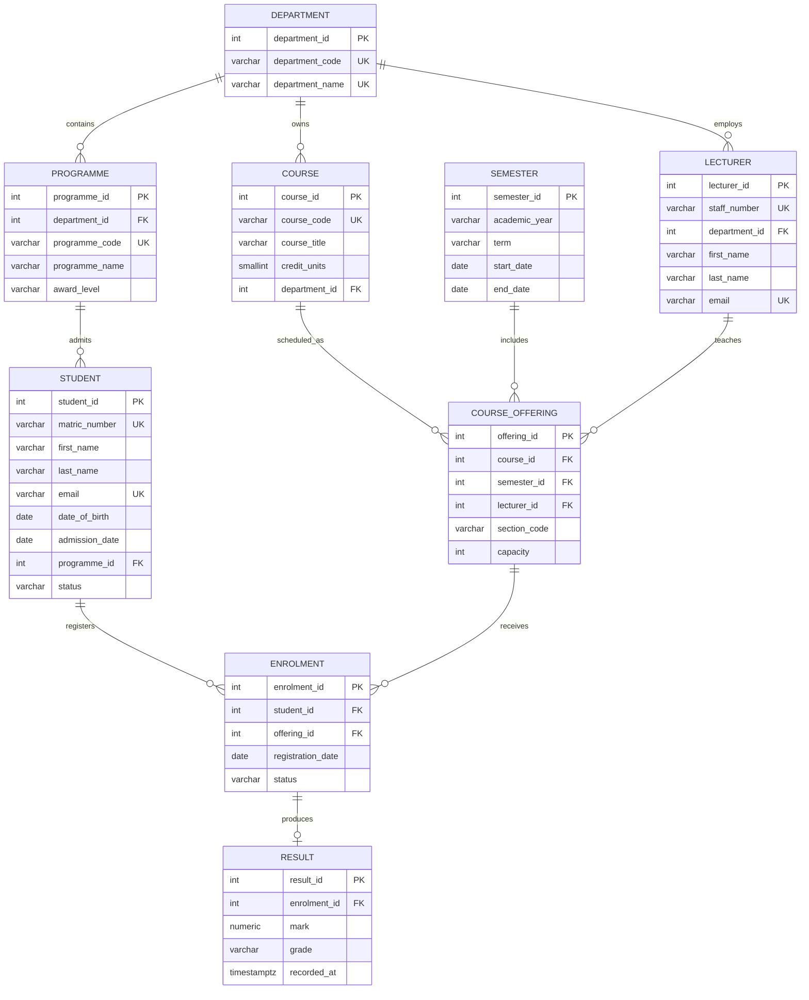

# Metropolitan University of Nigeria
## Student Registration and Result Management System

### Database Integrity Constraints

1. ENROLMENT has a composite UNIQUE constraint on (student_id, offering_id), preventing a student from registering for the same course offering more than once.

2. RESULT.enrolment_id is UNIQUE and NOT NULL, ensuring that each enrolment can have at most one result record.

3. Every RESULT must reference an existing ENROLMENT.

4. PROGRAMME enforces uniqueness of (department_id, programme_name).

5. SEMESTER enforces uniqueness of (academic_year, term).

6. COURSE_OFFERING enforces uniqueness of (course_id, semester_id, section_code).
